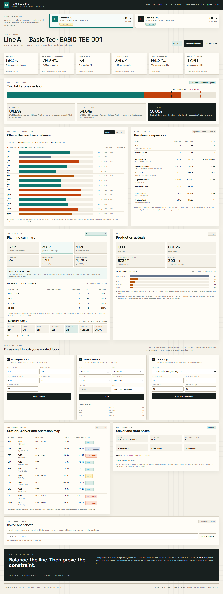

# LineBalance Pro

**Garment line balancing, capacity planning, and IE analytics — powered by a lexicographic MILP.**

LineBalance Pro turns a garment style's operation routing, SAM, skill matrix, and machine list into an optimized line. Every operation is assigned to exactly one station, every worker to at most one station, and precedence, skill, and machine constraints are enforced before the solver reports a result.

[](https://github.com/HH1112HH/linebalance-pro/actions/workflows/ci.yml)




> **Data policy:** this public demo ships **synthetic data only**. It contains no production data from any manufacturer and is not a substitute for a validated time study.

---

## What it does

| Area | Capability |
|---|---|
| **Line balancing** | MILP assignment with precedence, skill grades, machine eligibility, quality gates, and worker availability |
| **Honest solver status** | `OPTIMAL` only when the lexicographic objective is proven; otherwise `FEASIBLE_LIMIT` |
| **KPI layer** | Demand takt, effective takt, bottleneck load, line balance efficiency, bottleneck-constrained capacity, labor utilization |
| **Capacity planning** | Headcount standard vs. actual, manpower gap, machine requirements, skill coverage, transfer suggestions |
| **Baseline comparison** | Synthetic current-state vs. optimized line: workers, stations, bottleneck, LBE, capacity, target achievement |
| **Production actuals** | Output achievement, actual labor efficiency, downtime by category, loss breakdown |
| **Time study** | Observed time aggregation with allowance and performance rating — human work only |
| **Export & snapshots** | XLSX workbook export; browser-local scenario snapshots |
| **Demo scenarios** | Scenario A (stretch target 420) and Scenario B (feasible target 400) |

---

## Architecture

```text
Browser
React 19 · Vite · TypeScript
        │  fetch("/api/*")
        ▼
FastAPI · Pydantic v2
        ├─ validation.py  normalize · feasibility · topological order
        ├─ heuristics.py  greedy warm start
        ├─ optimizer.py   PuLP / HiGHS MILP
        ├─ kpis.py        pure KPI calculation
        ├─ planning.py    capacity · headcount · machines
        ├─ baseline.py    before/after comparison
        ├─ actuals.py     production actuals · downtime
        └─ excel.py       XLSX export
```

The solver runs a **two-stage lexicographic MILP**:

1. Minimize the number of workers (stations).
2. With that worker count fixed, minimize the bottleneck station load.

`OPTIMAL` is reported only when both stages are proven within the time limit.

### Sample benchmark

Synthetic 40-operation line, 60 s solver limit, 2 solver threads:

| Scenario | Workers | Status | Bottleneck | Stations | Capacity @ 85% | Target |
|---|---:|---|---:|---:|---:|---|
| A — stretch | 24 | `OPTIMAL` | 58.0 s | 23 | 395.7 | 420 not met |
| B — feasible | 25 used (26 available) | `OPTIMAL` | 56.0 s | 25 | 409.8 | 400 met |

Target 420 requires a bottleneck of at most 54.64 s. With 24 workers, 58.0 s is the **proven optimum**, not a timeout. Results depend on hardware, solver version, and the configured time limit.

---

## Quick start

**Prerequisites:** Python 3.12 and Node.js 20.19+ (or 22.12+).

### Backend

```bash
python -m venv .venv

# Windows
.venv\Scripts\Activate.ps1
# macOS / Linux
source .venv/bin/activate

pip install -r backend/requirements-dev.txt   # includes test dependencies
uvicorn backend.app.main:app --reload --port 8000
```

API docs: <http://127.0.0.1:8000/docs>  
Health check: <http://127.0.0.1:8000/api/health>

### Frontend

```bash
npm --prefix frontend install
npm --prefix frontend run dev
```

Open <http://localhost:5173>. Vite proxies `/api/*` to `127.0.0.1:8000`.

---

## Verify

One command runs the same gates as CI:

```powershell
powershell -ExecutionPolicy Bypass -File scripts/verify.ps1
```

Or run each step:

```bash
python -m pytest
python -m ruff check backend tests
python -m ruff format --check backend tests
python -m mypy backend/app

npm --prefix frontend run lint
npm --prefix frontend run format:check
npm --prefix frontend run typecheck
npm --prefix frontend run build
```

CI (`.github/workflows/ci.yml`) runs two parallel jobs on every push to `main` and every pull request:

- **Backend:** Python 3.12 → install `backend/requirements-dev.txt` → Ruff lint/format → mypy → `pytest`
- **Frontend:** Node 22 → `npm ci` → ESLint → Prettier check → `typecheck` → `build`

### Code quality

| Layer | Tool | Config |
|---|---|---|
| Python lint / format | Ruff | [`ruff.toml`](ruff.toml) |
| Python types | mypy | [`mypy.ini`](mypy.ini) |
| TypeScript / React | ESLint 10 + typescript-eslint | [`frontend/eslint.config.js`](frontend/eslint.config.js) |
| Frontend formatting | Prettier | [`frontend/.prettierrc.json`](frontend/.prettierrc.json) |
| Tests | pytest + FastAPI TestClient | [`pytest.ini`](pytest.ini) |
| Coverage | pytest-cov, minimum 80% | [`pytest.ini`](pytest.ini) |

---

## API

| Method | Endpoint | Purpose |
|---|---|---|
| `GET` | `/api/health` | Solver availability, public limits, data policy |
| `GET` | `/api/sample` | Scenario A request (stretch target 420) |
| `GET` | `/api/sample/feasible` | Scenario B request (feasible target 400) |
| `GET` | `/api/samples` | Both sample requests |
| `POST` | `/api/optimize` | Run the MILP and return stations, KPIs, planning, and baseline |
| `POST` | `/api/export` | Build an XLSX workbook |
| `POST` | `/api/actuals/analyze` | Analyze production actuals and downtime |
| `POST` | `/api/time-study/calculate` | Aggregate a time study |

### Solver status contract

| Status | Meaning |
|---|---|
| `OPTIMAL` | Both lexicographic stages proven; `metadata.lexicographic_proven = true` |
| `FEASIBLE_LIMIT` | A feasible line was found, but optimality was not proven within the time limit |
| `INFEASIBLE` | No assignment satisfies the constraints |
| `ERROR` | Solver or validation failure |

The UI never presents `FEASIBLE_LIMIT` as optimal.

### KPI naming

| Term | Meaning |
|---|---|
| **Demand takt** | Net available seconds ÷ target quantity |
| **Effective takt** | Demand takt adjusted for planned efficiency |
| **Capacity per shift** | Bottleneck-constrained planning capacity — **not** actual output |
| **Machine coverage** | Required vs. available machines — **not** machine utilization |

The full formula contract lives in [`KPI_SPEC.md`](KPI_SPEC.md).

---

## Project layout

```text
backend/app/          FastAPI app, MILP, KPI, planning, actuals
frontend/src/         React UI, API client, typed contracts
tests/                pytest suite (solver invariants, KPI, API)
docs/                 IE playbook and case studies
scripts/verify.ps1    Local quality gate
.github/workflows/    GitHub Actions CI
ruff.toml             Python lint/format config
mypy.ini              Python type-check config
frontend/eslint.config.js  ESLint flat config
frontend/.prettierrc.json  Prettier config
KPI_SPEC.md           KPI formula and naming contract
MODEL.md              MILP formulation and status rules
ROADMAP.md            Scope, architecture, and Definition of Done
CHECKLIST.md          Review checklist and decision log
DEPLOYMENT.md         Render / Netlify deployment and env vars
```

---

## Documentation

| Document | Contents |
|---|---|
| [`KPI_SPEC.md`](KPI_SPEC.md) | KPI formulas, units, rounding, naming rules, test checklist |
| [`MODEL.md`](MODEL.md) | Sets, variables, constraints, lexicographic objective |
| [`ROADMAP.md`](ROADMAP.md) | Scope, architecture, task breakdown, Definition of Done |
| [`CHECKLIST.md`](CHECKLIST.md) | Audit results, technical decisions, current status |
| [`DEPLOYMENT.md`](DEPLOYMENT.md) | Deployment steps, environment variables, security limits |
| [`CONTRIBUTING.md`](CONTRIBUTING.md) | Local setup, quality gates, commit style, PR checklist |
| [`SECURITY.md`](SECURITY.md) | Reporting policy, scope, existing controls |
| [`docs/IE_OPERATIONS_PLAYBOOK.md`](docs/IE_OPERATIONS_PLAYBOOK.md) | IE / Lean operating playbook |
| [`docs/CASE_STUDY_QUALITY_RCA.md`](docs/CASE_STUDY_QUALITY_RCA.md) | Quality RCA case study |
| [`docs/CASE_STUDY_KAIZEN.md`](docs/CASE_STUDY_KAIZEN.md) | Kaizen / cost-saving case study |

---

## Deployment

| Service | Platform | Config |
|---|---|---|
| API | Render (Python 3.12) | [`render.yaml`](render.yaml) |
| UI | Netlify (static Vite build) | [`netlify.toml`](netlify.toml) |

Environment variables, CORS, rate limits, and body limits are documented in [`DEPLOYMENT.md`](DEPLOYMENT.md).

---

## What this project demonstrates

- **Operations research:** two-stage lexicographic MILP, warm start, time limits, and truthful solver status.
- **Industrial engineering:** SAM, takt, line balance efficiency, bottleneck capacity, headcount, skill matrix, and machine requirements.
- **Full-stack delivery:** typed FastAPI contracts, React/TypeScript UI, pytest, CI, and deploy configs.
- **Engineering discipline:** documented KPI contract, MILP model, decision log, and a single local verification gate.

---

## Limitations

- **Synthetic demo only.** No real factory, payroll, or production data is included.
- **No authentication, database, multi-plant, real-time MES, or machine integration.**
- **Capacity is a planning estimate**, constrained by the bottleneck — not verified output.
- **Machine coverage is not utilization**; runtime, OEE, and breakdown data are out of scope.
- **The solver is time-limited.** Large instances may return `FEASIBLE_LIMIT` instead of a proof.
- **Time study aggregation applies to human work only**; automatic machine time is not performance-rated.

---

## License

MIT — see [`LICENSE`](LICENSE). The synthetic demo data is included for evaluation only.

---

<p align="center">
  <sub>Built with FastAPI · PuLP · HiGHS · React · TypeScript · Vite</sub>
</p>
