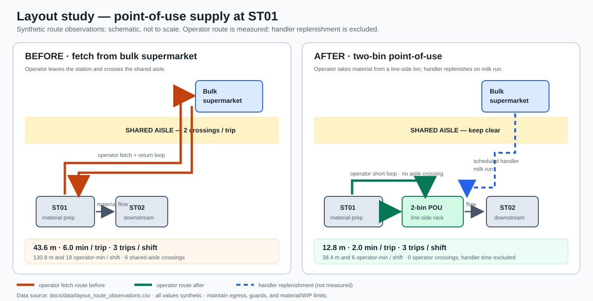

# Case Study — Layout & Ergonomics: Point-of-Use Material at ST01

> **Loại:** Case study layout/ergonomics, không phải module phần mềm.
> **Dữ liệu:** 100% synthetic; không phải dữ liệu HBI.
> **Phạm vi:** `LINE_01`, điểm cấp vật tư `ST01`, một tuyến replenishment.
> **Nguồn:** `docs/data/waste_observation.csv` (baseline 3 × 6 phút) và `docs/data/layout_route_observations.csv` (5 route trials mỗi giai đoạn).
> **Sơ đồ:** [`layout_study_before_after.svg`](layout_study_before_after.svg), schematic không theo tỷ lệ.

---

## 1. Tóm tắt

| Chỉ số | Trước | Sau pilot synthetic | Delta |
|---|---:|---:|---:|
| Round-trip distance / trip | 43.6 m | 12.8 m | −30.8 m (−70.64%) |
| Operator trip time / trip | 6.0 phút | 2.0 phút | −4.0 phút (−66.67%) |
| Replenishment trips / shift | 3 | 3 | Không đổi |
| Operator walking distance / shift | 130.8 m | 38.4 m | −92.4 m |
| Operator travel time / shift | 18.0 operator-min | 6.0 operator-min | −12.0 operator-min |
| Operator crossings of shared aisle / shift | 6 | 0 | −6 |

**Đề xuất:** đặt two-bin point-of-use rack ở khu line-side gần ST01, ngoài lối đi và vùng bảo vệ máy; Material Handler bổ sung theo milk run. Giữ nguyên routing, station và WIP control.

**Không claim:** 12 operator-min là cash saving hay total labor saving. Thời gian người cấp liệu replenishment chưa đo; hiện chỉ đo **walking của operator tại ST01**.

---

## 2. Define — vấn đề và phạm vi

### Problem statement

Trong ví dụ synthetic, operator tại ST01 rời vị trí để đi đến bulk supermarket lấy vật tư. Tuyến đi cắt shared aisle và quay về. Waste log ghi **3 trips/shift × 6 phút/trip = 18 operator-min/shift**. Đây là di chuyển không tạo giá trị và làm operator rời station; dữ liệu hiện có **không chứng minh** nó đã gây line stop hoặc thiếu sản lượng.

### Mục tiêu pilot

1. Giảm ít nhất 50% distance và time cho operator trip, giữ nguyên số lần replenishment để so sánh cùng điều kiện.
2. Operator không phải cắt shared aisle để lấy vật tư; aisle và exit luôn thông thoáng.
3. Không làm tăng material starvation, WIP, lỗi lẫn size/style hoặc cycle time tại ST01.
4. EHS và operator xác nhận vị trí/chiều cao/tải trọng của rack trước khi triển khai.

Mục tiêu 50% là **target synthetic cho bài tập**, không phải tiêu chuẩn nhà máy.

### In-scope / out-of-scope

| Trong phạm vi | Ngoài phạm vi |
|---|---|
| Tuyến operator từ ST01 đến điểm lấy vật tư và quay lại | Re-layout toàn bộ chuyền hoặc đổi routing |
| Point-of-use rack, FIFO/two-bin trigger, replenishment ownership | CAD, construction, đánh giá kết cấu hoặc Fire/EHS approval thật |
| Distance, trip time, aisle crossing; ergonomic screen | Tính total labor saving khi chưa đo milk-run handler time |
| Bảo toàn quality, WIP và lối thoát | Claim năng suất/quality/safety improvement từ dữ liệu synthetic |

---

## 3. Measure — cách thu thập và kết quả

### Cách đo

- Ghi 5 round-trip trials trước và 5 sau, cùng điểm start/end, cùng loại tote và cùng cách tính.
- Distance đo theo **đường đi thực tế trên lối được phép**, không đo đường thẳng xuyên máy/bàn.
- Trip time bấm từ lúc rời ST01 đến lúc quay lại; ghi riêng chờ nếu có.
- Aisle crossing đếm mỗi lần operator cắt qua shared aisle; không quy đổi crossing thành phút.
- Số lần replenishment là **3/shift**, lấy từ `waste_observation.csv`; không giảm số trip để làm đẹp kết quả.
- Log sau chỉ đo operator đi đến line-side bin. Thời gian Material Handler đưa bin từ supermarket đến POU **chưa đo**.

### Kết quả route trials

| Giai đoạn | Distance/trial (m) | Time/trial (min) | Crossings/trial |
|---|---|---|---:|
| BEFORE | 42, 44, 43, 46, 43 | 5.8, 6.2, 6.1, 5.9, 6.0 | 2 mỗi trial |
| AFTER | 12, 13, 14, 12, 13 | 2.1, 1.9, 2.0, 2.1, 1.9 | 0 mỗi trial |
| **Mean BEFORE** | **43.6** | **6.0** | **2** |
| **Mean AFTER** | **12.8** | **2.0** | **0** |

CSV: `docs/data/layout_route_observations.csv`. Tất cả bản ghi có `data_policy=SYNTHETIC`.

---

## 4. Analyze — spaghetti diagram và dòng vật tư



### Before

```text
Operator at ST01 → cross shared aisle → bulk supermarket
Operator at ST01 ← cross shared aisle ← return empty tote
```

Mỗi round trip có 2 crossings. Với 3 trips/shift là **6 operator crossings/shift**. Root cause trực tiếp theo giả định case là bulk material point-of-use không có; vật tư được đặt ở supermarket phía bên kia aisle.

### After

```text
Bulk supermarket ── scheduled Material Handler milk run ──> 2-bin POU
Operator at ST01 ── short line-side trip ──> POU
Material flow: ST01 → downstream, FIFO; không đổi thứ tự công đoạn
```

Operator không rời khu vực để cắt shared aisle. Milk-run handler là **một luồng khác**; không được bỏ qua khi tính tổng labor.

### Lựa chọn layout

| Layout | Thường phù hợp khi | Trade-off cần kiểm tra |
|---|---|---|
| Straight line | Volume cao, routing ổn định, flow một chiều | Khoảng cách đầu-cuối dài; phải quản lý crossings và point-of-use |
| U-shaped cell | Nhiều operation gần nhau, cần giao tiếp/linh hoạt người vận hành | Có thể gây congestion, giao cắt vào/ra; không phù hợp mọi máy/guarding |
| L-shaped | Bị giới hạn bởi cột/tường hoặc cần đổi hướng flow | Dễ tạo điểm nghẽn ở góc; phải kiểm tra material handling |
| Process/functional | Nhiều loại sản phẩm/routing khác nhau | Tăng transport/WIP nếu không có pull và tuyến cấp liệu rõ |

**Quyết định case:** chỉ chuyển supermarket thành POU + milk run. Không đủ dữ liệu để kết luận cần đổi cả line sang U-shape; không di chuyển máy hoặc sửa routing.

---

## 5. Verify — tính trước/sau

Với 3 replenishment trips/shift:

```text
Distance before = 43.6 m/trip × 3 = 130.8 m/shift
Distance after  = 12.8 m/trip × 3 =  38.4 m/shift
Distance reduction = (130.8 − 38.4) / 130.8 × 100 = 70.64%

Operator time before = 6.0 min/trip × 3 = 18.0 operator-min/shift
Operator time after  = 2.0 min/trip × 3 =  6.0 operator-min/shift
Operator time reduction = (18 − 6) / 18 × 100 = 66.67%

Shared-aisle crossings: 2 × 3 = 6 → 0 × 3 = 0 per shift
```

### Cách đọc đúng

- Route distance giảm **70.64%**, operator trip time giảm **66.67%**, với số trip không đổi.
- 12 operator-min/shift là **movement time tránh được ở operator ST01**, không phải tiền tiết kiệm và chưa phải net labor saving.
- Material Handler hiện phải cấp/refill bin; chưa có time study cho milk-run. Muốn kết luận total labor impact, đo riêng handler operator-minutes trước/sau.
- Chưa có dữ liệu line stop/throughput để claim output tăng.
- 0 aisle crossing của operator không có nghĩa toàn bộ aisle không còn traffic; phải đánh giá tuyến handler và lối thoát riêng.

---

## 6. Improve — thiết kế và pilot

1. Vẽ layout hiện trạng và đánh dấu machine guard, electrical panel, aisle, exit, fire equipment.
2. Đặt POU rack trong khu line-side gần ST01 nhưng **ngoài** aisle, egress, vùng bảo vệ máy và đường cấp liệu khác.
3. Dùng two-bin/FIFO: chỉ đặt lượng đủ theo consumption và replenishment lead time. Không tăng batch hoặc WIP cap để tránh operator đi lấy vật tư.
4. Gắn nhãn style/size/lot, vị trí và min/max. Quy định ai báo empty bin, ai refill, tần suất milk run và cách xử lý thiếu vật tư.
5. Chạy 5 route trials trong cùng điều kiện; kiểm tra chất lượng/nhầm vật tư, starvation, WIP và station cycle.
6. Nếu target đạt mà có lỗi quality, lối đi bị cản hoặc handler phải overtime, **không accept**; sửa layout/trigger và chạy lại pilot.

### Ergonomics screen — checklist trước khi chấp thuận

| Yếu tố | Câu hỏi tại chỗ | Hành động/owner |
|---|---|---|
| Reach | Vật tư dùng thường xuyên có nằm trong vùng với thoải mái không? Có vặn thân/đưa tay qua máy không? | Operator + IE thử thao tác; đặt lại bin nếu phải với/vặn |
| Lift/carry | Tote nặng bao nhiêu? Có nâng từ sàn, nâng cao, kẹp tay hoặc mang xa không? | Đo tải và tần suất; EHS đánh giá; dùng cart/giảm tải nếu cần |
| Push/pull | Handler có phải đẩy xe qua dốc, gờ hoặc cua hẹp không? | EHS/Material Handler kiểm tra lực, bánh xe, lối đi |
| Repetition/posture | Lấy/đặt lặp lại có gây cúi, xoay, giữ tĩnh hoặc với quá mức không? | Quan sát chu kỳ; điều chỉnh vị trí và độ cao rack |
| Visibility/lighting | Nhãn/lot có đọc được, có glare/bóng đổ không? | Cải thiện nhãn/ánh sáng theo chuẩn EHS tại nơi làm việc |
| Aisle/egress | Rack, tote hoặc xe có lấn aisle, exit, fire equipment không? | EHS/Facilities xác nhận clearance theo site rule; không tự chọn số đo |
| Machine/safety | Rack có chạm moving parts, guard, dây điện hoặc tạo điểm va chạm không? | Maintenance/EHS duyệt vị trí trước khi pilot |

**Không chấm RULA/REBA/NIOSH từ ảnh hoặc dữ liệu synthetic.** Dùng phương pháp phù hợp chỉ khi người đánh giá được đào tạo và có quan sát/tải trọng thật; kết quả phải do EHS phê duyệt.

---

## 7. Control Plan

| KPI / điều kiện | Target pilot | Tần suất | Owner | Reaction |
|---|---:|---|---|---|
| Operator trip distance | ≤21.8 m/trip (giảm ≥50% baseline) | 5 trials đầu, sau đó weekly sample | IE | Không đạt → map lại route, kiểm tra POU location |
| Operator trip time | ≤3.0 min/trip (giảm ≥50%) | 5 trials đầu, sau đó weekly sample | Line leader | >3.0 phút → xem shortage/waiting/route |
| Operator shared-aisle crossing | 0 cho trip ST01–POU | Mỗi lần pilot/audit | EHS + Supervisor | Có crossing → sửa route, không chấp nhận shortcut qua aisle |
| Material availability tại ST01 | Không starvation do POU/milk run | Mỗi ca | Material Handler | Thiếu bin → refill/escalate, ghi downtime riêng nếu có |
| FIFO/lot/style identification | 100% đúng theo visual check | Mỗi replenishment | Quality + Warehouse | Nhầm/mất traceability → hold material, containment |
| Handler time / labor impact | Đo riêng, chưa có target trước baseline | Pilot | IE + Warehouse | Chưa có log → không claim net labor saving |
| Ergonomics/aisle clearance | EHS approval trước triển khai | Trước pilot và khi đổi vị trí | EHS + Facilities | Chưa duyệt hoặc có hazard → dừng pilot, sửa layout |

**Reaction rule:** nếu operator trip giảm nhưng material starvation, handler overtime, WIP tăng hoặc aisle/ergonomics fail, pilot **không đạt**; không tối ưu một waste bằng cách chuyển lãng phí sang người/bộ phận khác.

---

## 8. Câu hỏi phỏng vấn

1. Spaghetti diagram dùng để làm gì và đo như thế nào?
2. Vì sao không đo khoảng cách đường chim bay?
3. U-shaped layout có luôn tốt hơn straight line không?
4. Làm sao biết POU rack không chỉ chuyển waste sang Material Handler?
5. Layout cải tiến mà WIP tăng thì xử lý thế nào?
6. Em kiểm tra ergonomics trước khi chuyển rack ra sao?

### Model answer — POU và xác minh kết quả

> Em map route thật từ ST01 đến supermarket, đo theo lối đi hợp lệ và bấm giờ cả lượt đi-về. Baseline synthetic là 43.6 m và 6 phút mỗi trip; ba trips/shift. Sau khi đặt two-bin POU, route operator còn 12.8 m và 2 phút. Nhưng em chưa gọi 12 operator-min là net saving vì chưa đo thời gian Material Handler refill bin. Em cũng giữ FIFO/WIP, kiểm tra material availability và xin EHS duyệt aisle, reach, tải trọng trước khi accept.

---

## 9. Giới hạn và checklist

### Giới hạn

- 5 route trials mỗi phase là ví dụ synthetic, không phải sample đủ cho kết luận thống kê hay production claim.
- Diagram schematic, không theo tỷ lệ; chưa phải drawing thi công.
- Chưa đo Material Handler time, tote mass, push/pull force, posture, reach envelope, incident hoặc line output.
- Không kết luận ergonomics/safety đã cải thiện nếu chưa có đánh giá EHS thật.
- Không đổi station, machine, process sequence hoặc KPI API.

### Checklist

- [x] Có spaghetti/layout diagram trước-sau; ghi rõ schematic, không theo tỷ lệ.
- [x] Có material flow supermarket → POU → ST01 → downstream và ownership replenishment.
- [x] Có 5 synthetic trials mỗi giai đoạn và phép tính distance/time/crossings.
- [x] Phân biệt operator time với Material Handler time; không claim cash/net labor saving.
- [x] Có lựa chọn layout straight/U/L/process cùng trade-off.
- [x] Có ergonomic screen cho reach, lift, push/pull, posture, lighting, aisle và machine safety.
- [x] Không tự chấm RULA/REBA/NIOSH hoặc claim safety improvement.
- [x] Có Control Plan và reaction rule chống chuyển waste.
- [ ] EHS/Facilities duyệt layout và clearance thật.
- [ ] Đo handler time, tote mass và ergonomic exposures thật.
- [ ] Pilot trên ca thật với output, WIP, quality và starvation theo dõi.

> **Kết luận:** ví dụ synthetic cho thấy POU có thể giảm 70.64% route distance và 66.67% operator trip time trong phạm vi được đo. Cần đo handler route và EHS review trước khi gọi đây là cải tiến vận hành đã xác minh.
